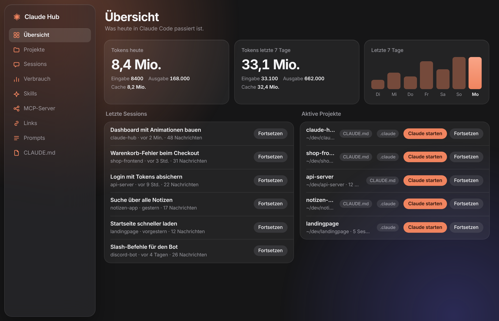

# Claude Hub

Desktop-Dashboard für [Claude Code](https://claude.com/claude-code) unter Linux: Projekte,
Sessions, Token-Verbrauch, Abo-Limits, Skills, MCP-Server, Links, Prompts und die globale
`CLAUDE.md` an einem Ort. Tauri 2, Rust-Kern, Web-Oberfläche ohne Build-Schritt.

Läuft auf jedem Linux-Desktop (KDE, GNOME, XFCE …), X11 und Wayland. Alle Daten liest die App
lokal aus `~/.claude`, es geht nichts ins Netz. Oberfläche auf Deutsch.

## Installieren

Voraussetzungen: [Claude Code](https://docs.claude.com/en/docs/claude-code), Rust
([rustup.rs](https://rustup.rs)), Node.js mit pnpm oder npm und die
[Tauri-Systempakete](https://v2.tauri.app/start/prerequisites/#linux). Fehlt etwas, nennt
`install.sh` den passenden Befehl für dnf, apt, pacman oder zypper.

    git clone https://github.com/Fynn7909/claude-hub.git
    cd claude-hub
    ./install.sh

Das Skript baut die App, legt sie ohne sudo nach `~/.local/bin/claude-hub` und trägt sie ins
Startmenü ein. Danach in der App-Suche „Claude Hub“ eingeben.

- `./install.sh --rebuild` baut nach einem `git pull` neu.
- `./install.sh --no-statusline` lässt `~/.claude/settings.json` unverändert (siehe Limits).
- Pakete statt Benutzer-Installation: `pnpm build` erzeugt `.deb` und `.rpm` unter
  `src-tauri/target/release/bundle/`.

### Abo-Limits

Das 5-Stunden-Fenster und das Wochenlimit (wie bei `/usage`) gibt Claude Code nur an die
Statuszeile weiter. `install.sh` installiert dafür `claude-hub-statusline` und trägt es als
Statuszeile ein, falls du noch keine hast. Hast du schon eine eigene, gib ihre Eingabe
zusätzlich an `claude-hub-statusline --quiet` weiter, zum Beispiel am Anfang deines Skripts:

    input=$(cat); printf '%s' "$input" | claude-hub-statusline --quiet

### Terminal

„Claude starten“ und „Fortsetzen“ öffnen ein Terminal im Projektordner. Genommen wird
`$TERMINAL`, sonst das erste gefundene aus konsole, gnome-terminal, ptyxis, kgx,
xfce4-terminal, tilix, kitty, alacritty, wezterm, foot, xterm.

## Widgets für KDE Plasma 6

- [claude-hub-widget](https://github.com/Fynn7909/claude-hub-widget): Verbrauch und laufende
  Sessions auf dem Desktop, Klick öffnet Claude Hub.
- [claude-buddy](https://github.com/Fynn7909/claude-buddy): Claude-Maskottchen, das wach ist,
  solange Claude Code arbeitet, und die letzte Antwort in einem Satz zusammenfasst.

## Datenquellen

| Bereich | Quelle |
|---|---|
| Skills | `~/.claude/skills/**/SKILL.md`. Ausschalten benennt die Datei in `SKILL.md.disabled` um. |
| Projekte | Ordner unter `~` (Tiefe 5) mit `CLAUDE.md` oder `.claude`, plus Ordner aus den Logs |
| Sessions, Verbrauch | `~/.claude/projects/**/*.jsonl` |
| Laufende Sessions | `~/.claude/sessions/*.json` |
| Limits | `~/.cache/claude-hub/limits.json` (von `claude-hub-statusline`) |
| MCP-Server | `~/.claude.json`, `.mcp.json` der Projekte |
| Links, Prompts | `~/.local/share/dev.franz.claude-hub/` |
| Globale CLAUDE.md | `~/.claude/CLAUDE.md` |

Der Erklär-Chat ruft `claude -p --model haiku` auf und läuft damit über dein eigenes Abo.

## Entwickeln

    pnpm install
    pnpm dev          # Entwicklung mit Neuladen
    pnpm build:bin    # nur Binary
    pnpm build        # Binary plus .deb und .rpm

    ui/              Oberfläche (HTML, CSS, JS-Module)
    src-tauri/src/   Rust-Befehle: logs, projects, skills, mcp, links, launch, live, limits, tray …
    scripts/         claude-hub-statusline

## Lizenz

MIT, siehe [LICENSE](LICENSE). Kein offizielles Produkt von Anthropic.
